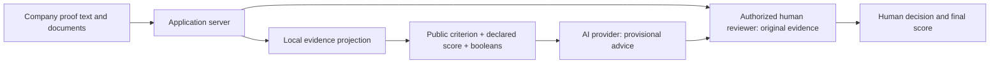

# AI evidence privacy boundary

The server now builds AI requests from a **closed set of evidence signals**, rather than sending proof text or attempting to redact a document with regular expressions. Protection is mandatory in the current AI call paths. There is no request parameter or configuration switch that permits raw document text.



## What leaves the application server

Only the public questionnaire code/title/pillar, a declared answer from `0`, `0.5`, `1`, `NA`, `unknown`, and fixed booleans:

| Signal | Meaning |
|---|---|
| `textProvided` | There is some proof text to inspect locally. |
| `auditMentioned` | An audit word is mentioned. |
| `certificateMentioned` | A certificate/certification/ISO word is mentioned. |
| `policyMentioned` | A policy/charter word is mentioned. |
| `invoiceMentioned` | An invoice word is mentioned. |
| `reportMentioned` | A report word is mentioned. |
| `registerMentioned` | A register word is mentioned. |
| `trainingMentioned` | A training word is mentioned. |
| `monitoringMentioned` | A monitoring/dashboard/indicator word is mentioned. |
| `dateMentioned` | A date-shaped reference occurs; the actual date is excluded. |

These are mentions, not verified facts. They do not confirm authenticity, relevance, compliance, or any document's numeric measurements. Provider prompts explicitly require cautious advice and human verification. The application still stores original evidence for authorized users and reviewers.

The outbound schema has **no field** for company/person names, contacts, addresses, identifiers, bank/tax numbers, salary/financial amounts, exact dates, filenames, document titles, raw notes/justifications, arbitrary metadata, document IDs or attachment bytes. Public question titles come from a server-owned catalog; client-supplied unknown codes/titles/scores cannot become arbitrary prompt text. Dossier review uses at most one item for each of the 27 known criteria, in catalog order.

Local text inspection is bounded to 64,000 characters per criterion. Unsupported/unknown values are discarded or mapped to fixed `unknown` values. No model is used to perform the privacy projection; it executes locally before the external call. If the projection cannot run, the raw input is never used as a remote fallback.

## Modes

**Signals-only is the default when a provider is configured.** The declared scores and evidence signals are still business information sent to that provider. This mode minimizes disclosure; it is not a claim that all derived information is non-sensitive or anonymous.

**Local-only disables AI-provider review calls completely**, even when an API key is configured. Use this when scores or evidence categories themselves must not leave the application:

```env
# ASP.NET Core environment variable
Ai__AllowRemote=false
```

For .NET JSON configuration, set `Ai.AllowRemote` to `false`. For hosted runtimes, restart/redeploy after changing configuration. Local-only uses bounded local heuristic advice and still requires human review.

No production configuration was changed and no deployment was performed. These changes do not revoke or delete data previously sent to providers, and do not constitute a broader assessment of authentication, document-storage permissions, provider retention, or hosting/logging configuration.

## Implemented paths

| Path | Mandatory projection |
|---|---|
| .NET `AiReviewService.ReviewQuestionAsync` → chat completions | `AiEvidencePrivacyFilter.Project` |
| .NET `AiReviewService.ReviewDossierAsync` → chat completions | `AiEvidencePrivacyFilter.ProjectDossier` |

Filename text is excluded from proof context. The decisive privacy control is on the server, so a modified browser cannot send arbitrary text onward to the model.

Responses include server-owned `privacy` metadata: `mode`, `rawDocumentTextSent=false`, `requiresHumanVerification=true`. Raw provider error bodies/transport exception messages are not returned in review fallback messages. The .NET service logs only the exception type, rather than an exception that might contain echoed request data.

## Verification

```powershell
npm run test:privacy
dotnet run --project backend/tests/Turritopsis.PrivacyChecks
npm run build
dotnet build backend/Turritopsis.sln
```

Tests use fictional secrets and capture the **actual outgoing HTTP body** for .NET question/dossier reviews. They check that source text, identifiers, exact dates, filenames, file bytes and injected instructions are absent. They also check catalog/score allowlisting, unknown/oversized input, zero-call local mode, and provider failures without secret-bearing error output/logs. No real customer documents or real AI provider calls are used by these tests.

When adding a provider or prompt in the future, route it through this projection and add a transport-boundary test. Do not interpolate request fields, store raw prompts in telemetry, or send unfiltered documents to an external model to anonymize them.
